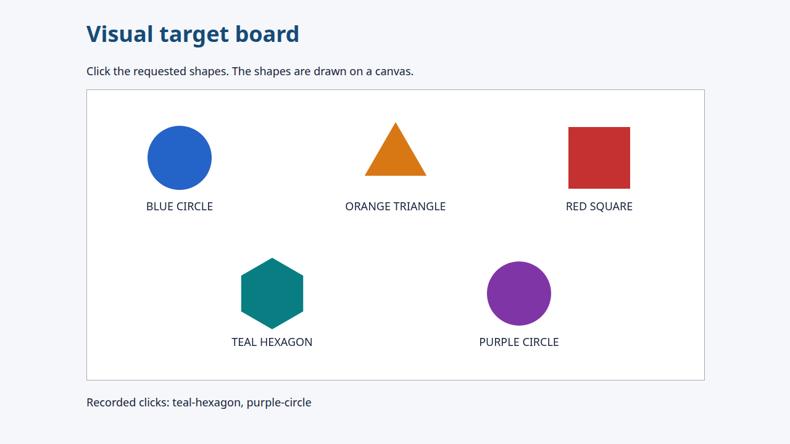

# NorthCUA on an RTX 3090: public local tests

**The final patched configuration completed 6/6 original browser tasks, the original visual probe, and 4/4 additional task variations.** The initial configuration completed 3/6 original browser tasks. Read the [before-and-after analysis](docs/hardening.md).

This repository preserves **41 real-model task runs** from November 13, 2026, including unsuccessful attempts. All tasks use synthetic projects, products, settings or visual targets.

- [Read the follow-up analysis and reproduce the fixes](docs/hardening.md)
- [Read the initial analysis](docs/analysis.md)
- [Browse the patched Harness source](https://github.com/CharitonMedia/northcua-lawlab-tests/tree/harness-patched)
- [Results table](results/summary.csv) and [structured summary](results/summary.json)
- [Reproduce the tests](docs/reproduce.md)
- [Hardware, model hashes and settings](results/environment/manifest.json)
- [Data integrity notes and limitations](docs/data-notes.md)
- [Videos and complete evidence download](https://github.com/CharitonMedia/northcua-lawlab-tests/releases/tag/2026-11-13-hardening)
- [X and Facebook drafts](docs/social-drafts.md)

## Watch the model work

These are continuous browser recordings in real time, without speed changes or narration. Original WebM files are included under each run.

| Recording | What it shows |
|---|---|
| [Shopping task](https://github.com/CharitonMedia/northcua-lawlab-tests/releases/download/2026-11-13-nano/nano-shopping-real-time.mp4) | Selecting the cheapest available lamp and submitting the correct test order |
| [Date failure](https://github.com/CharitonMedia/northcua-lawlab-tests/releases/download/2026-11-13-nano/nano-date-failure-real-time.mp4) | A malformed date argument stops the first project-form run |
| [Adapted visual clicks](https://github.com/CharitonMedia/northcua-lawlab-tests/releases/download/2026-11-13-nano/nano-visual-adapted-real-time.mp4) | Both canvas targets register after an explicit coordinate conversion |

## Scope

The model is mradermacher's Q8_0 NorthCUA-Nano GGUF with its f16 vision projector. The original Harness snapshot and patched source are both pinned. Inference used one RTX 3090 with 128K configured capacity; the browser ran on a separate Linux controller host.

Most baseline tasks use DOM references plus screenshots. A separate canvas probe tests point actions. Assisted follow-ups are reported separately. Neither research-benchmark reproduction nor native Desktop, Mini, Hermes or Grok Bot acceptance is claimed.

The optional LLM evaluator was disabled. Saved fixture data is checked independently, and a full pass also requires successful harness termination. A correct save and a clean completion are distinct columns.

The repository includes task prompts, expected outcomes, actual receipts, configurations, source pins, model-call captures, screenshots, videos and failed attempts. See the analysis for three overlapping runs excluded from single-task latency interpretation and the preserved correction to early capture labels.
