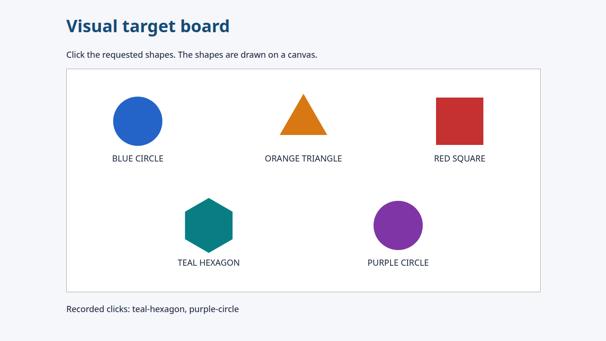

# NorthCUA-Nano on an RTX 3090: useful browser control, three distinct failure modes

Staff | November 13, 2026

**Follow-up:** Request captures later showed that these initial runs used the generic NexAU system prompt. The [patched-harness study](hardening.md) reports the fixes, all development stages and eleven successful final runs. Original scores remain unchanged.

NorthCUA-Nano fully completed **three of six baseline browser runs** on a single RTX 3090. Four runs saved the requested data correctly; one of those kept switching tabs until it hit the 20-step limit. The two project forms stopped when the model supplied a date format that the browser tool rejected.

We retained **12 model-task runs**, including prompt-sensitivity checks, a sequential repeat, and a separate visual-coordinate probe. These are small synthetic tasks. They measure this local configuration, not OSWorld or WebArena performance.

[Machine-readable results](../results/summary.csv) · [Full JSON summary](../results/summary.json) · [Reproduction](reproduce.md)

## What ran

| Component | Tested configuration |
|---|---|
| Model | NorthCUA-Nano, nominal 9B dense parameters |
| Weights | mradermacher Q8_0 GGUF, 9,527,502,016 bytes; matching f16 vision projector |
| GPU | RTX 3090, 24,576 MiB; loaded-idle allocation observed at 12,272 MiB |
| GPU host | EPYC 7532, 32 cores / 64 threads; 251 GiB RAM; Linux 7.0.0-43 |
| Inference | llama.cpp build 12359, commit `b1b770d90`; pinned CUDA container digest |
| Context | 131,072 server capacity; harness limit 128,000 tokens |
| Sampling | Temperature 0; thinking disabled; maximum 4,096 output tokens per call |
| Execution | One server slot; Q8 KV cache; Flash Attention; 20 harness steps per task |
| Harness | Official NorthCUA snapshot `b904a8fc4fbc16de0197a142f6dd9ab2bd36ffff` |
| Browser | Headless Chromium 145.0.7632.6; Playwright 1.58.0; 1280 × 720 viewport |

The GPU server and browser controller ran on separate Linux hosts, connected through an SSH tunnel. [The manifest](../results/environment/manifest.json) records hashes and settings. The 128K setting is capacity; these short runs did not stress that entire window. The VRAM figure is an observed loaded-idle snapshot, not peak memory.

## Baseline results

A full pass requires both a successful harness termination and an exact match between the requested values and the server-side saved receipt. A model saying it finished isn't sufficient. The optional LLM evaluator was disabled; independent checks use fixture state.

| Run | Saved state correct | Fully completed | Steps | Wall time |
|---|---:|---:|---:|---:|
| Project A | No | No: malformed date | 1 | 18.10 s |
| Project B | No | No: malformed date | 1 | 13.69 s |
| Shop A | Yes | Yes | 4 | 20.40 s |
| Shop B | Yes | Yes | 4 | 17.00 s |
| Settings A | Yes | Yes | 11 | 39.50 s |
| Settings B | Yes | No: step limit | 20 | 82.28 s* |

The shop tasks required choosing the least expensive in-stock lamp while rejecting a cheaper unavailable lamp. Nano selected SKU L17. It produced the correct totals for three lamps with Express delivery ($81) and two with Standard delivery ($49).

Settings A required changing six values across two tabs, saving and reopening them. Settings B saved all six requested values but then alternated between the Notifications button and the Reload saved settings link. A fresh sequential repeat also hit the limit, taking 71.93 seconds.

*Settings B overlapped with two follow-up runs because the first version of the runner lacked a suite lock. Its latency and both overlapping follow-up latencies are excluded from single-task timing interpretation. All affected runs remain in the data. The runner now serializes task execution.*

## Dates: one tool failure ended the round

For Project A, Nano issued seven tool calls in its first step. The date call supplied `12/01/2026` to an HTML date input. Playwright's fill operation expected an ISO value and returned “Malformed value.” Other calls in the batch executed, but the harness terminated with `tool_error` before the project was saved. Project B repeated the same failure with `01/15/2027`.

We then added one explicit instruction: “When filling an HTML date input, pass its value in YYYY-MM-DD format.” Both variants passed. A further sequential Project A check passed in 23.41 seconds. These **three assisted successes are separate from the baseline**; they don't erase either failure.

## Vision: the model found the shapes, but the coordinate contract mattered

The visual probe drew shapes inside a canvas, without individual DOM controls. Nano was asked to click the teal hexagon and then the purple circle.

In the unadapted run, it called `web_click_point` at `(346, 658)` and `(658, 658)`. The browser interpreted those as viewport pixels. Neither click reached the canvas targets; the fixture saved no receipt. Nano still reported the requested sequence, and the harness reported completion.

Those coordinates fit a 0–1000 representation of the visible target locations. NorthCUA's model card specifies normalized coordinates; the Harness's Web point-tool contract uses CSS pixels. Its Desktop coordinate setting doesn't change Web point actions.

For a separate run, our capture proxy explicitly converted `web_click_point` results from 0–1000 into the fixed 1280 × 720 viewport. It delivered clicks at `(443, 474)` and `(842, 474)`. Both targets registered in the correct order, and Nano finished in 12.79 seconds.

This is an **adapter-assisted result**. The unmodified failure, original model responses, converted arguments and successful receipt are all retained. A scripted fixture control separately checked that the canvas event handler and persistent receipt worked; that control isn't counted as a model run.

## Speed and what these runs establish

The three clean baseline completions took 17.00–39.50 seconds. llama.cpp reported roughly 81–82 generated tokens per second across these runs. That decode measurement excludes prompt processing, vision work, browser actions and orchestration, so it isn't the task-completion rate.

The basic browser-control path works locally: the real Nano checkpoint received screenshots and structured tools, produced function calls, changed browser state, and returned results. Most tasks used DOM references alongside screenshots. The canvas probe separately exercised point clicks.

The failures expose separate integration and stopping problems. Date controls need a representation the tool accepts. Point actions need a shared coordinate convention. A task can save correct values and still fail to terminate; it can also claim completion without changing the requested state. The public evidence preserves those distinctions.

We haven't tested Mini, native Desktop control, long-duration unattended work, Hermes invocation, or Grok Bot invocation. These runs establish a callable CLI path through the harness; a shared MCP adapter remains future work.

## Evidence and recording

Every run has its prompt, expected values, independent outcome, console output, harness trace, screenshots and continuous browser video. The recordings are **real time**, without speed changes or voiceover. Three MP4 viewing copies are available alongside the original WebM files:

- [Successful shopping task](https://github.com/CharitonMedia/northcua-lawlab-tests/releases/download/2026-11-13-nano/nano-shopping-real-time.mp4)
- [Date-format failure](https://github.com/CharitonMedia/northcua-lawlab-tests/releases/download/2026-11-13-nano/nano-date-failure-real-time.mp4)
- [Coordinate-adapted visual task](https://github.com/CharitonMedia/northcua-lawlab-tests/releases/download/2026-11-13-nano/nano-visual-adapted-real-time.mp4)

The capture proxy strips request headers, stores embedded images as hashed files and records model requests/responses. An early shared run-label file misattributed 14 calls during overlapping runs. The original capture is preserved; the canonical capture derives run identity from each request's `user` field and retains the old label. Later captures use that field directly. See [data notes](data-notes.md).

Sources: [NorthCUA model card](https://huggingface.co/beipo-ai/NorthCUA-Nano), [Harness execution modes](https://github.com/beipo-ai/NorthCUA/blob/main/docs/running.md), and the pinned local source and experiment evidence linked above.
