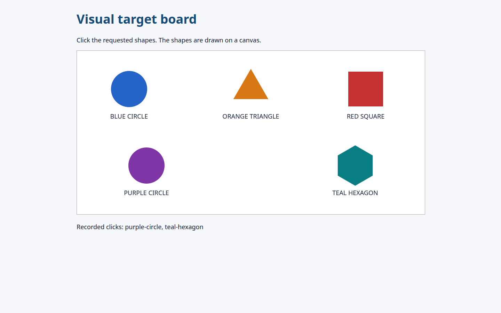

# NorthCUA follow-up: the code fixes and the prompt that wasn't being sent

Staff | November 13, 2026, US Central

NorthCUA-Nano completed **all six original browser tasks** after the final harness changes, compared with three of six in the initial configuration. It also passed the original canvas-clicking probe and four additional task variations, including a changed layout at a 1440 × 900 viewport. All eleven final runs matched the independently checked fixture state and terminated successfully.

The full data set now contains **41 real-model runs**. Earlier unsuccessful stages remain public. Nine regression tests and four scripted integration controls are recorded separately; they aren't counted as model-capability runs.

[All run results](../results/summary.csv) · [Grouped data](../results/hardening/group-summary.json) · [Prompt audit](../results/hardening/prompt-audit.json) · [Patched source](https://github.com/CharitonMedia/northcua-lawlab-tests/tree/harness-patched)

## Before and after

| Test group | Initial configuration | Final patched configuration |
|---|---:|---:|
| Six original DOM-assisted browser tasks | 3/6 fully completed; 4/6 saved correctly | 6/6 fully completed and saved correctly |
| Original canvas point-click probe, without the temporary proxy adapter | 0/1 independently verified | 1/1 independently verified |
| Four additional task variations | Introduced during follow-up | 4/4 completed and independently verified |

The additional cases changed the project name/date/budget, asked for the most expensive available lamp rather than the cheapest, changed settings requirements, and moved the canvas targets while reversing the requested click order. These variations first ran under V2 and were repeated under V3. They aren't an independently held-out benchmark.

The model weights, Q8_0 quantization, 3090, 128K capacity, temperature zero, disabled thinking and 20-step budget stayed the same.

| Final original run | Full pass | Steps | Wall time |
|---|---:|---:|---:|
| Project A | Yes | 10 | 41.00 s |
| Project B | Yes | 9 | 35.43 s |
| Shop A | Yes | 6 | 23.66 s |
| Shop B | Yes | 5 | 20.40 s |
| Settings A | Yes | 11 | 41.91 s |
| Settings B | Yes | 11 | 41.26 s |

Exact measurements, including the variation and visual-probe timings, are in the CSV. Completion improved; the changes don't establish a general speed gain. For example, Project A now performs the requested work rather than stopping at its first malformed date.

## An important finding in the actual requests

The generated agent configuration didn't load the intended NorthCUA Web system template. The model received NexAU's generic default instructions, including “You currently have no tools available,” while native tools were supplied separately in the API request.

The request audit found that generic prompt in all 41 baseline calls and in the V1/V2 original-case calls. The browser-specific template was present in **all 81 final V3 calls**, including the task variations. File contents alone wouldn't have established that; the capture proxy recorded what reached the model.

The fix assigns the bundled Web Jinja template when an agent has no explicit system prompt. It preserves a caller's custom prompt. This activates the existing browser instructions together with the added date-format and stopping rules.

The initial results remain valid observations of the configuration used. They should be read as configuration tests, not as a limit on the released Nano checkpoint.

## Permanent changes

**Coordinate mapping now belongs to the browser backend.** A per-model Web policy selects `viewport_css` or `normalized_1000`. The backend reads the current viewport, converts once and applies the configured bounds policy. Clicks, double-clicks and both drag endpoints share this mapping. Ref actions remain unscaled. Action overlays use the corresponding frame.

The former proxy converter was fixed at 1280 × 720. The final runs don't use that converter. The changed-layout visual test passed at 1440 × 900 using the backend's dynamic mapping. Real-browser regression checks also resize a live page and check the click and drag endpoints.

**Date controls identify their required format.** Tool descriptions and page observations specify YYYY-MM-DD. The backend validates date-input values before attempting the fill. Invalid dates return a correctable error and a hint, without changing the field or silently interpreting an ambiguous date. The configured recovery budget is three erroneous steps; the fourth ends the run.

**Repeated action cycles receive bounded recovery.** Detection uses the action and observed page state, rather than counting every repeated tool name. A repeated cycle produces a retained runtime-feedback message. A second unresolved cycle terminates with a clear failure.

V1 revealed a delivery bug in our first implementation: attaching feedback to the original query didn't put it into later history-based requests. V2 delivers a new retained user message instead. Actual request captures and a scripted integration control verify that the message reaches the model.

**Completion can require a rendered receipt.** When configured, the harness checks a visible, nonempty confirmation selector before accepting a final completion message. Missing evidence returns feedback, and recovery is bounded. This blocks the demonstrated empty-receipt false completion.

A nonempty receipt isn't a universal verifier of every requested value. The independent field-by-field checks still decide the reported full-pass score. Other sites must configure their own meaningful confirmation selector, or leave this optional check off for tasks that don't produce receipts.

## Development stages remain visible

| Stage | Original six tasks | Original canvas probe | Additional variations |
|---|---:|---:|---:|
| Baseline | 3/6 | 0/1 | Not run |
| V1: backend/input changes; feedback delivery ineffective | 4/6 | 1/1 | Not run |
| V2: retained recovery feedback | 5/6 | 1/1 | 4/4 |
| V3: intended Web system prompt also loaded | 6/6 | 1/1 | 4/4 |

V1 regressed Settings A into a loop. V2 recovered that case, while Settings B still exhausted bounded progress. Both cases completed under V3. The data supports this tested combination of changes; it doesn't isolate a universal benefit from every individual rule.

One description in the first write-up has been corrected: the loop alternated the **Notifications button and Reload saved settings link**, rather than the Display and Notifications buttons. The traces, outcomes and original scores are unchanged.

## Validation, source and recordings

Nine regression tests cover dynamic mapping, pixel-mode preservation, boundary rejection/clamping, drag endpoints, date correction, rendered receipt checks, cycle detection and default/custom prompt behavior. Ruff, formatting checks and the configured Pyright scope pass. Four end-to-end scripted controls check false-completion rejection, feedback delivery, date recovery and exhaustion of the recovery budget.

The final model runs used source commit `e3d1125d3398e19967c9f973f50559f28b3b4aff`. The published formatted source is `e1ccd1b32e280448367e1ec9e96cd14a6e9e2a02`. Formatting preserved the executable AST of every affected Python file; the equivalence record and final checks are included.

- [Complete final patch](../patches/northcua-web-hardening.patch)
- [Patched source branch](https://github.com/CharitonMedia/northcua-lawlab-tests/tree/harness-patched)
- [Regression and scripted-control evidence](../results/hardening/)
- [Fixed settings task, real-time MP4](https://github.com/CharitonMedia/northcua-lawlab-tests/releases/download/2026-11-13-hardening/nano-settings-fixed-real-time.mp4)
- [Changed-layout visual task, real-time MP4](https://github.com/CharitonMedia/northcua-lawlab-tests/releases/download/2026-11-13-hardening/nano-wide-visual-fixed-real-time.mp4)



Original WebM recordings, screenshots, requests/responses and all failed development runs are preserved. The final runs are sequential. Earlier overlap and capture-label corrections remain documented in the original data notes.

## Reproduce the patched configuration

Follow the original model-serving and browser setup in [reproduce.md](reproduce.md). For the source, clone this repository's source branch into a fresh vendor directory and pin the published revision:

```sh
git clone --branch harness-patched https://github.com/CharitonMedia/northcua-lawlab-tests.git vendor/NorthCUA
git -C vendor/NorthCUA checkout e1ccd1b32e280448367e1ec9e96cd14a6e9e2a02
```

Install the locked dependencies and Chromium as before. Start the fixture server and capture proxy. Use fresh run tags:

```sh
python3 scripts/run_suite.py --case settings-b --tag my-patched-run --config config/nano-q8-hardened/app.example.yaml
python3 scripts/run_suite.py --case vision-b --tag my-wide-run --config config/nano-q8-hardened/app.wide.yaml
```

The ordinary proxy records calls without coordinate rewriting for those tags. The `coordinate-adapted-` prefix remains reserved for the historical proxy-assisted experiment.

These tests cover a small, manually authored collection of browser tasks. They don't establish reliability across unfamiliar applications, native Desktop control, long unattended sessions, Mini, or an actual Hermes/Grok Bot connection.
